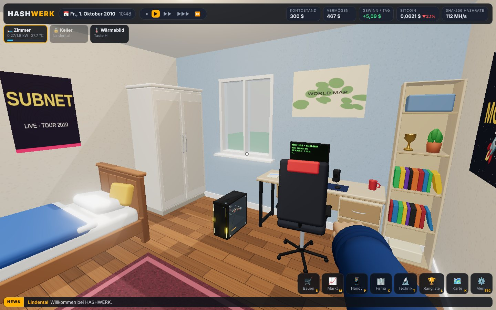
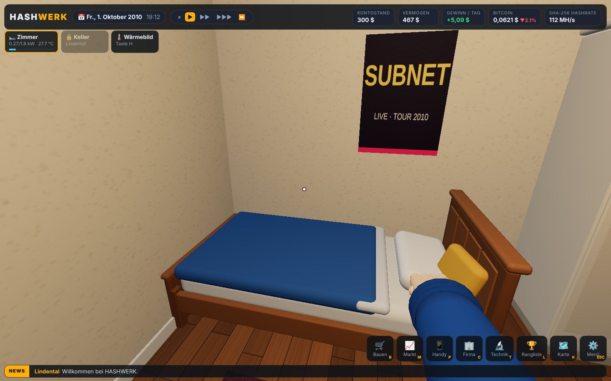
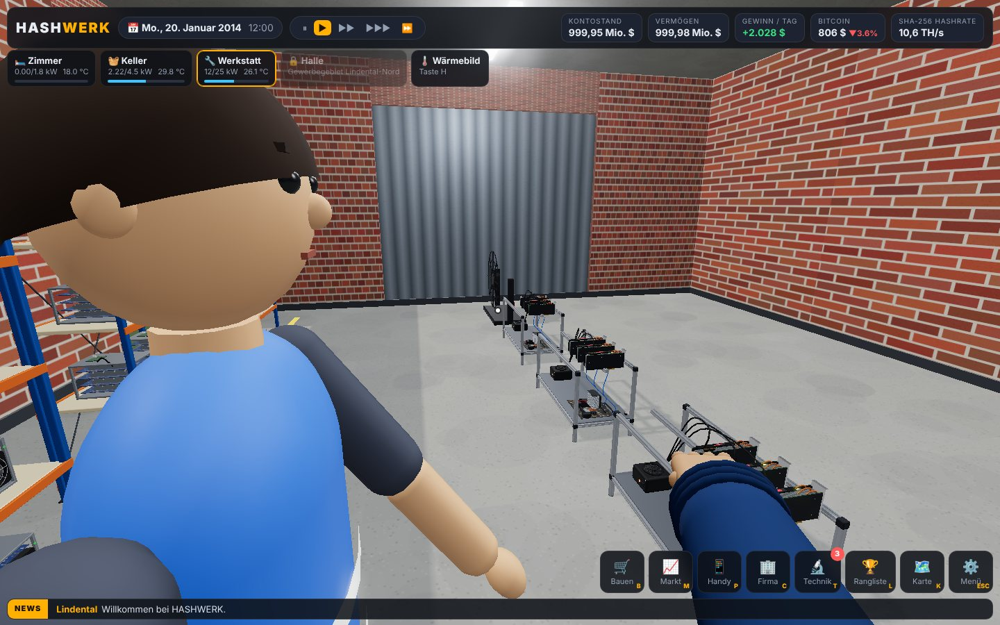
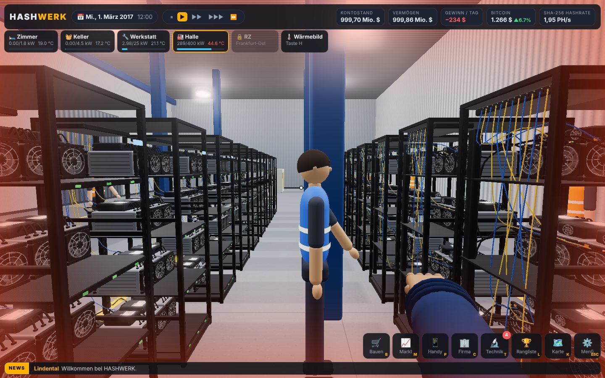
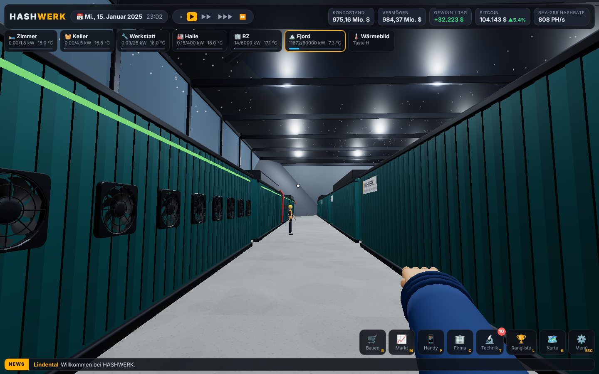

# HASHWERK – Vom Kinderzimmer zum Rechenzentrum

Ein 3D-Krypto-Mining-Tycoon in **Ego-Perspektive** im Browser (Three.js). Inspiriert von der Mechanik aus
„Crypto Miner Tycoon Simulator", aber mit eigener Story, echter 3D-Welt und viel größerem Maßstab:
Du startest **Oktober 2010 im Kinderzimmer** mit einem alten PC und baust bis in die Gegenwart
(November 2026) ein Mining-Imperium bis zur **60-MW-Wasserkrafthalle am Fjord** auf.





| | |
|---|---|
|  |  |
|  |  |
|  |  |

**Imperium-Ansicht** – alle Standorte im Größenvergleich:


**Nachts** zwischen den Containern der Fjordhalle, mit Polarlicht:



Recherche: [docs/RECHERCHE.md](docs/RECHERCHE.md) · Konzept & Story: [docs/KONZEPT.md](docs/KONZEPT.md)

## Spielen

**Ohne Installation:** `play/HASHWERK.html` herunterladen und im Browser (Chrome/Edge/Firefox) öffnen –
alles steckt in dieser einen Datei.

**Entwicklung:**

```bash
npm install
```

```bash
npm run dev
```

Dann <http://localhost:5173> öffnen. Ein Hinweis-Balken oben führt Schritt für Schritt durch Kapitel 1. Statischer Build: `npm run build` (Ausgabe in `dist/`),
Ein-Datei-Version neu bauen: `npm run build:single`.

## Was drin ist

* **Echte Geschichte als Spielwelt:** Bitcoin-Kurs und Netz-Hashrate (2010–2026) aus gerundeten
  historischen Stützpunkten, Halvings 2012/16/20/24, GoxBank-Pleite 2014, China-Bann 2021,
  Merge 2022, FXT-Kollaps 2022, ETF 2024, Allzeithoch Okt. 2025. Danach Endlosmodus.
* **Ertrag wie in echt:** `Coins/Tag = Deine Hashrate / Netz-Hashrate × Emission`. Dazu 8 weitere
  echte Coins (Litecoin, Dogecoin, Monero, Ethereum, Ethereum Classic, Zcash, Ravencoin,
  Kaspa) – inkl. Merged Mining, RandomX-Wechsel, DAG-Grenzen für 3/4-GB-Karten und Ende des
  GPU-Minings beim Merge.
* **~130 Hardware-Teile** mit fiktiven Marken (Crimson/Verdant-GPUs, Silicor/Arix-CPUs,
  Fieldforge-FPGAs, Swarm/Whirl/Glacier-ASICs), Preise folgen GPU-Boom und Hashprice.
* **Rig-Bau mit Slots:** Mainboard, CPU, Netzteil, bis zu 12 GPUs – sichtbar im 3D-Modell mit
  drehenden Lüftern. Schnellbau, „Mit bester GPU füllen", Duplizieren.
* **6 Standorte:** Kinderzimmer → Hobbykeller → Werkstatt → Lagerhalle → Rechenzentrum → Fjordhalle,
  alle laufen parallel. Strom (Sicherung fliegt!), Hitze (Drosselung, Defekte), Miete, Techniker.
* **Story:** Papas Elektronikladen retten, Opa Heinz legt Starkstrom, Kumpel Deniz wird CTO,
  Rivale Viktor Kral (MONOLITH Hash AG) muss überholt werden. Nachrichten aufs Handy, News-Ticker.
* **Imperium-Ansicht (🗺️):** alle Standorte nebeneinander als Dioramen – vom Kinderzimmer bis zur Fjordhalle.
* **Fähigkeiten (T):** ein großer Baum von 2010 bis zum Endspiel. Wissen schaltet Handgriffe frei statt Prozent-Boni: Betriebssystem installieren (Windows-Lizenz oder Linux), USB-Image, BIOS-Profile Eco/Turbo, ASIC-Takt, Firmware flashen, Autotuning, Wartung, Löten (Mini-Spiel bei Reparaturen), Wasserkühlung, FPGA-Bitstream, Limit-Orders, Großhandel und Robi, der Bastelroboter. Lernen durch Tun (Punkte), im Forum, aus Büchern (Paket), in Kursen oder bei Leuten.
* **Wetter & Welt:** echte Hitzewellen (2015–2025) heizen die Räume auf, Schnee im Winter, Polarlicht am Fjord, im Dezember ein Weihnachtsbaum.
* **Solaranlagen (☀️):** pro Standort ausbaubar, saisonaler Ertrag wie in Deutschland, als Modulfeld in 3D.
* **Bankkredit:** schneller wachsen mit historischen Zinsen – mit dem Risiko von 2022.
* **Feedback:** schwebende Ertrags-Einblendungen über laufenden Geräten, Kurs-Alarme bei starken Bewegungen,
  Rangliste mit Hashrate-Kurve gegen das Netz und „Dein Weg" mit allen Meilensteinen.
* **Wärmebild (H):** zeigt Hitzequellen und Kühlbereiche wie die Overlays im Vorbild.
* **Ego-Perspektive:** Du läufst selbst durch Zimmer, Keller und Hallen. Mit dem Fadenkreuz schaust
  du Geräte an und öffnest sie mit **E**. Du baust mit dem Tablet direkt vor dir, gehst durch Türen
  zu anderen Standorten und benutzt Gegenstände: Am PC-Monitor setzt du dich, die Kamera fährt an den Bildschirm, dort läuft ein Browser mit Shop und Börse; im Bett schläfst du.
  Dazu kommen eigene Hände, eine Taschenlampe, Schritte und Kollision.
* **Handmodellierte 3D-Modelle (alle selbst gebaut, keine fremden Assets, keine Logos):**
  * Abgerundete und gefaste Kanten überall, gebogene und verdrehte Lüfterflügel.
  * Lüfterrahmen mit Streben und Drahtgittern, echte Lamellenkühler mit Heatpipes.
  * Grafikkarten mit Lüfterabdeckung, Backplate, Goldkontakten, Slotblech und Stromsteckern.
  * Alu-Strebenprofile mit Nuten an den Open-Air-Rigs, verlegte Riser- und Stromkabel.
  * Mining-Racks mit Switch, Steckdosenleiste und Verkabelung.
  * Container mit Wellblech, Eckbeschlägen und Verriegelungsstangen, Etiketten mit Barcode und QR-Code.
  * Figuren mit Gelenken und Gesicht, Möbel mit weichen Polstern.
* **Grafik und Leistung:** Modelle werden nach Material gebacken und haben drei Detailstufen (LOD),
  damit auch volle Hallen flüssig laufen. Dazu Tag/Nacht und Bloom-LEDs.

## Steuerung

| Eingabe | Aktion |
|---|---|
| Klick ins Bild | Maus einfangen (Ego-Steuerung) |
| Maus | Umsehen |
| WASD / Pfeile | Laufen (Shift = rennen) |
| E / Linksklick | Benutzen: Gerät öffnen, Tür, PC-Monitor, Bett … / beim Bauen: setzen |
| B | Shop (Browser-Reiter, auch am PC-Monitor), danach steht das Teil vor dir bzw. kommt als Paket |
| R | Beim Bauen drehen |
| Rechtsklick / X | Bauen abbrechen |
| Shift + Klick | Mehrfach bauen |
| Entf (2×) | Angeschautes Gerät verkaufen |
| M / P / C / T / L / K | Börse (Browser-Reiter), Handy, Firma, Fähigkeiten (auch J), Rangliste, Karte (Imperium) |
| G | Ziel bezahlen (z. B. Papas Stromrechnung, Ladenschulden) |
| H | Wärmebild |
| F | Taschenlampe |
| Leertaste, 1–4 | Pause, Tempo |
| ESC | Menü / Fenster schließen |

Auf Touch-Geräten gibt es einen Joystick, Wischen zum Umsehen und Tasten für Benutzen, Bauen und Menü.

## Projektstruktur

```
docs/RECHERCHE.md   Recherche zum Vorbild + Echtdaten
docs/KONZEPT.md     Spielkonzept & Story
src/data/           Kurs-/Hashrate-Kurven, Coins, Hardware, Standorte, Story
src/sim/game.js     Simulation (Mining, Strom, Hitze, Defekte, Markt, Ziele)
src/world/          Three.js: Materialien, Modelle (models.js, furniture.js), Räume, Spieler (player.js),
                    Hände/Tablet (viewmodel.js), Welt/Interaktion/Bauen (world.js)
src/ui/             Oberfläche, Sound
```

Alle Marken- und Produktnamen im Spiel sind fiktiv. Kursdaten sind gerundet und dienen nur dem Spiel – kein Finanzrat.
