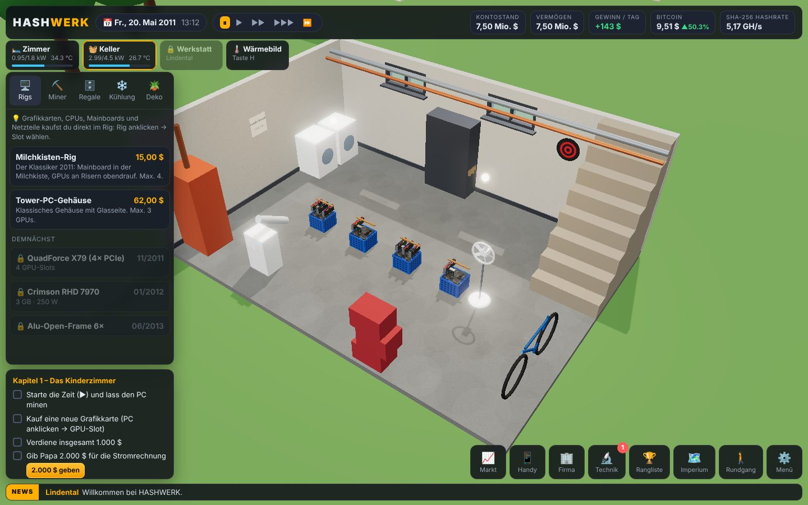
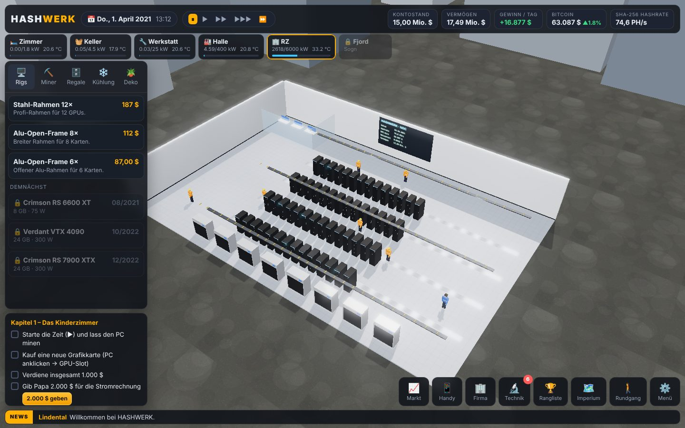
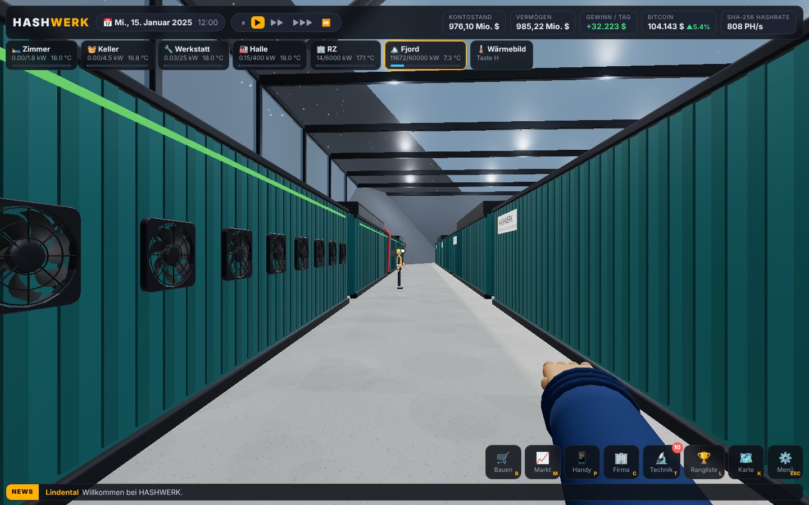
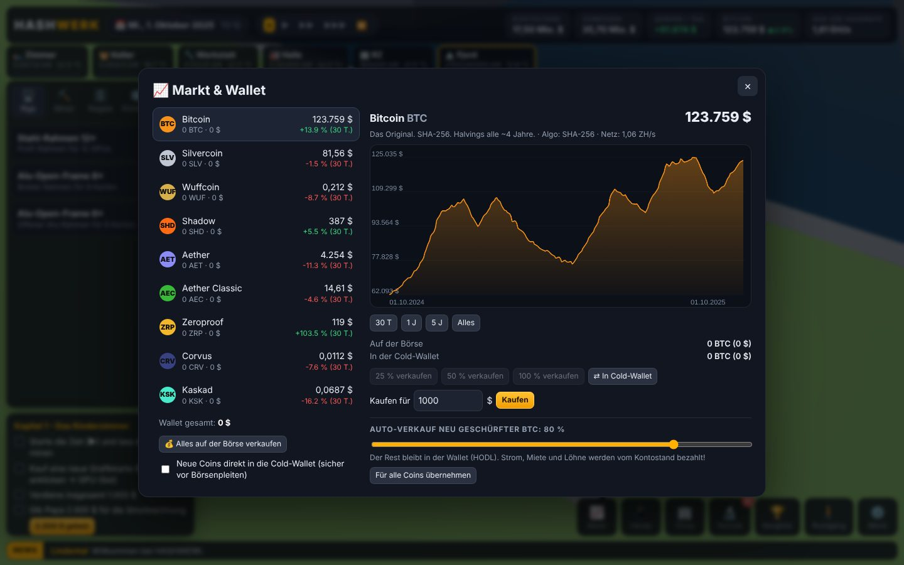
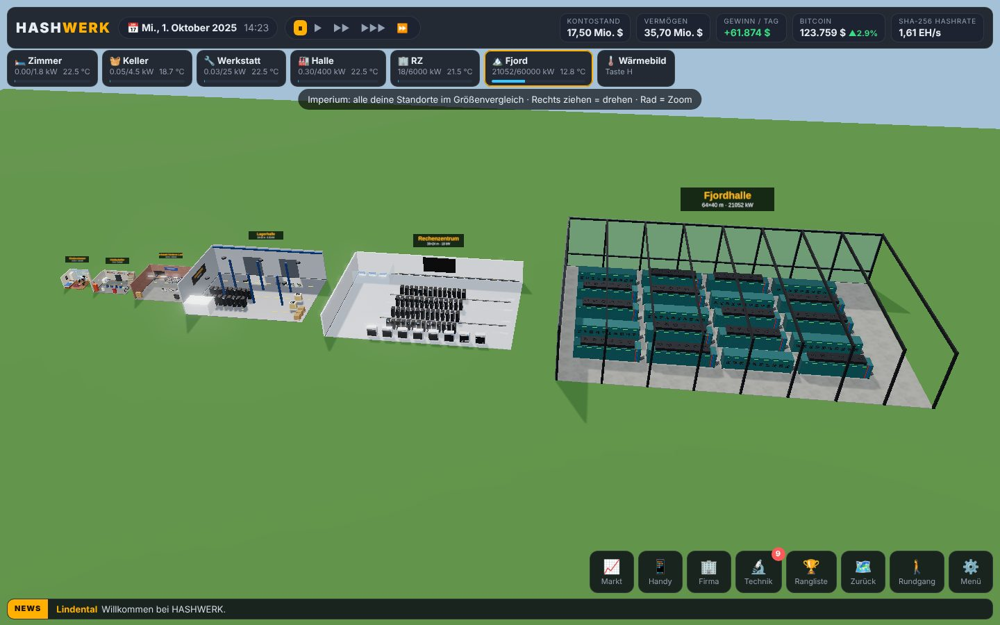

# HASHWERK – Vom Kinderzimmer zum Rechenzentrum

Ein 3D-Krypto-Mining-Tycoon im Browser (Three.js). Inspiriert von der Mechanik aus
„Crypto Miner Tycoon Simulator", aber mit eigener Story, echter 3D-Welt und viel größerem Maßstab:
Du startest **Oktober 2010 im Kinderzimmer** mit einem alten PC und baust bis in die Gegenwart
(November 2026) ein Mining-Imperium bis zur **60-MW-Wasserkrafthalle am Fjord** auf.


| | |
|---|---|
|  |  |
|  |  |
|  |  |

**Imperium-Ansicht** – alle Standorte im Größenvergleich:



**Rundgang** – nachts zwischen den Containern der Fjordhalle, mit Polarlicht:


Recherche: [docs/RECHERCHE.md](docs/RECHERCHE.md) · Konzept & Story: [docs/KONZEPT.md](docs/KONZEPT.md)

## Spielen

**Ohne Installation:** `play/HASHWERK.html` herunterladen und im Browser (Chrome/Edge/Firefox) öffnen –
alles steckt in dieser einen Datei.

**Entwicklung:**

```bash
npm install
```

```bash
npm run dev
```

Dann <http://localhost:5173> öffnen. Statischer Build: `npm run build` (Ausgabe in `dist/`),
Ein-Datei-Version neu bauen: `npm run build:single`.

## Was drin ist

* **Echte Geschichte als Spielwelt:** Bitcoin-Kurs und Netz-Hashrate (2010–2026) aus gerundeten
  historischen Stützpunkten, Halvings 2012/16/20/24, GoxBank-Pleite 2014, China-Bann 2021,
  Merge 2022, FXT-Kollaps 2022, ETF 2024, Allzeithoch Okt. 2025. Danach Endlosmodus.
* **Ertrag wie in echt:** `Coins/Tag = Deine Hashrate / Netz-Hashrate × Emission`. Dazu 8 weitere
  Coins mit Parodie-Namen (Silvercoin, Wuffcoin, Shadow, Aether, Aether Classic, Zeroproof, Corvus,
  Kaskad) – inkl. Merged Mining, RandomX-Wechsel, DAG-Grenzen für 3/4-GB-Karten und Ende des
  GPU-Minings beim Merge.
* **~130 Hardware-Teile** mit fiktiven Marken (Crimson/Verdant-GPUs, Silicor/Arix-CPUs,
  Fieldforge-FPGAs, Swarm/Whirl/Glacier-ASICs), Preise folgen GPU-Boom und Hashprice.
* **Rig-Bau mit Slots:** Mainboard, CPU, Netzteil, bis zu 12 GPUs – sichtbar im 3D-Modell mit
  drehenden Lüftern. Schnellbau, „Mit bester GPU füllen", Duplizieren.
* **6 Standorte:** Kinderzimmer → Hobbykeller → Werkstatt → Lagerhalle → Rechenzentrum → Fjordhalle,
  alle laufen parallel. Strom (Sicherung fliegt!), Hitze (Drosselung, Defekte), Miete, Techniker.
* **Story:** Papas Elektronikladen retten, Opa Heinz legt Starkstrom, Kumpel Deniz wird CTO,
  Rivale Viktor Kral (MONOLITH Hash AG) muss überholt werden. Nachrichten aufs Handy, News-Ticker.
* **Imperium-Ansicht (🗺️):** alle Standorte nebeneinander als Dioramen – vom Kinderzimmer bis zur Fjordhalle.
* **Technik (🔬):** 10 Technologien wie Undervolting, eigene ASIC-Firmware, eigener Coin per ICO (2017, Erlös in Aether), Immersionskühlung, Abwärme-Verkauf.
* **Wetter & Welt:** echte Hitzewellen (2015–2025) heizen die Räume auf, Schnee im Winter, Polarlicht am Fjord.
* **Solaranlagen (☀️):** pro Standort ausbaubar, saisonaler Ertrag wie in Deutschland, als Modulfeld in 3D.
* **Bankkredit:** schneller wachsen mit historischen Zinsen – mit dem Risiko von 2022.
* **Wärmebild (H):** zeigt Hitzequellen und Kühlbereiche wie die Overlays im Vorbild.
* **3D:** Alle Modelle prozedural im Code gebaut (keine fremden Assets, keine Logos), Tag/Nacht,
  Bloom-LEDs, Wände blenden sich zur Kamera aus, Rundgang-Modus in Ego-Perspektive.

## Steuerung

| Eingabe | Aktion |
|---|---|
| Linksklick | Objekt auswählen / bauen |
| Rechts ziehen | Kamera drehen |
| Mitte ziehen | Kamera schieben |
| Mausrad | Zoom |
| WASD / Pfeile, Q/E | Kamera bewegen / drehen |
| R | Beim Bauen drehen |
| Shift | Mehrfach bauen |
| Leertaste, 1–4 | Pause, Tempo |
| F | Rundgang (Ego-Perspektive) |

## Projektstruktur

```
docs/RECHERCHE.md   Recherche zum Vorbild + Echtdaten
docs/KONZEPT.md     Spielkonzept & Story
src/data/           Kurs-/Hashrate-Kurven, Coins, Hardware, Standorte, Story
src/sim/game.js     Simulation (Mining, Strom, Hitze, Defekte, Markt, Ziele)
src/world/          Three.js: Materialien, Modelle, Räume, Welt/Kamera/Bauen
src/ui/             Oberfläche, Sound
```

Alle Marken- und Produktnamen im Spiel sind fiktiv. Kursdaten sind gerundet und dienen nur dem Spiel – kein Finanzrat.
